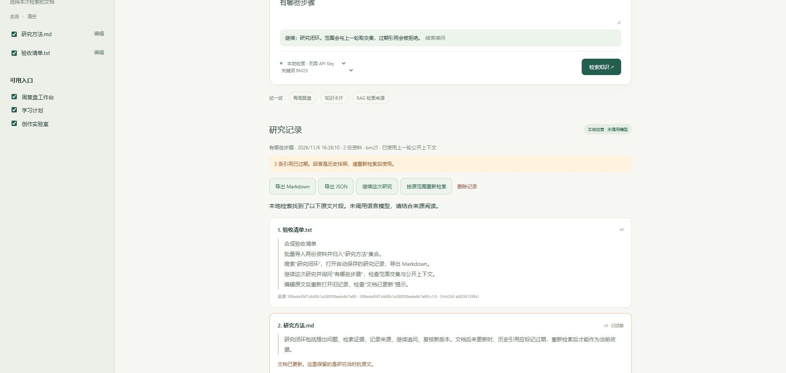

# 知径 · Knowledge Navigator v0.2

把 TXT/Markdown 资料导入本机知识库，按集合限定检索范围，保存带原文引用的研究记录，并从已有研究继续追问。默认使用真实 SQLite FTS5/BM25，无需 API Key；可选真实 embedding 混合召回与有界模型工具循环。

技术栈：Python 3.11+、FastAPI、SQLite、原生 HTML/CSS/JavaScript。新增代码 MIT，来源协议适配文件保留 Mulan PSL v2。

## 启动

Windows（首次安装需要网络）：

```powershell
powershell -ExecutionPolicy Bypass -File scripts/setup.ps1
powershell -ExecutionPolicy Bypass -File scripts/start.ps1
```

打开 http://127.0.0.1:8792，端口冲突可加 `-Port 8794`。首次创建 `data/knowledge.sqlite3` 和 4 份合成笔记；已有 v0.1 数据库自动增加集合、研究记录和向量缓存表，保留文档、版本、索引及历史，不重新播种已清空的库。迁移前可自行复制 SQLite 文件做备份。

其他系统：

```bash
python -m venv .venv
source .venv/bin/activate
python -m pip install -r requirements.lock
python -m pip install --no-deps -e .
python -m uvicorn navigator.main:app --host 127.0.0.1 --port 8792
```

## 三分钟实际操作

1. 左侧“管理”创建“研究方法”集合，选择该集合。
2. 点“导入 TXT / MD”，选择 `examples/研究方法.md` 和 `examples/验收清单.txt`；也可以拖到左侧导入区域。确认整批文件与目标集合后导入。
3. 搜索“研究闭环”。查看真实原文、版本、SHA256、动作耗时；研究记录自动保存。
4. 点“继续这次研究”，输入“有哪些步骤”。本地模式使用上一轮问题补全关键词；Agent 模式会收到有界公开上下文。后端将文档和入口范围与上一轮取交集。
5. 编辑“研究方法.md”并保存。旧研究仍保留原文，重新打开显示“文档已更新 / 引用已过期”；过期父记录不能继续注入旧证据。
6. 导出 Markdown 或 JSON；导出会再次复核引用。按原范围重新检索生成新记录，旧记录不会被覆盖。可以单独删除研究记录。



## 导入、集合与研究记录

- 导入只接受严格 UTF-8（允许 BOM）的 `.txt` / `.md`，每批 1–20 个、单文件 256 KiB、整批 2 MiB、正文最多 80000 字符；HTTP 请求最多 3 MiB。文件名不能包含路径分隔符、盘符或控制字符，且只作为数据库标题，永不写成磁盘路径。
- 整批先解码和校验，再在一个 SQLite 事务里写文档、分块及 FTS。任一校验或写入失败，整批不落库。同名文件创建独立文档，不覆盖已有内容。
- 集合支持创建、改名、删除；文档可在编辑器里移动集合。删除集合仅将资料归入“未归档”。集合与单独勾选的文档范围取交集，空范围始终为空。
- 搜索命中、未命中、模型/向量服务失败都保存服务器实际结果；客户端不能直接伪造研究快照。历史保存 query、实际 scope、引用、回答及公开动作摘要，不保存模型隐藏思维、API Key 或原始上游错误。
- 读取和导出历史时，在当前数据库快照中比对版本、哈希与原文。历史回答不会自动更新；任何旧引用都逐项标记过期。文档删除不删除研究记录。

主要接口：`/api/documents/import`、`/api/collections`、`/api/search`、`/api/research`、`/api/research/{id}/export?format=md|json`。启动后的 `/docs` 可查看其余 API；批量导入的 JSON 结构是 `files: [{filename, content_base64}]`，可附 `collection_id`、`entry_ids`。

## 检索路径与真实向量服务

界面分别选择回答方式和召回方式：

| 选择 | 实际行为 |
|---|---|
| 本地 + BM25 | FTS5/中文双字词检索，展示原文；不调用外部服务 |
| 本地 + 混合 | 在原始范围内取 BM25 与真实向量候选，用 RRF 融合；仍只展示证据 |
| Agent + 任一种召回 | 模型控制 `search → read → final`；只有本轮实际读取的原文可作为引用 |

复制 `.env.example` 为 `.env`，按需填写：

```dotenv
MODEL_BASE_URL=http://127.0.0.1:8000/v1
MODEL_NAME=your-chat-model
MODEL_API_KEY=
MODEL_TIMEOUT=30
MODEL_MAX_STEPS=6
EMBEDDING_BASE_URL=http://127.0.0.1:8000/v1
EMBEDDING_NAME=your-embedding-model
EMBEDDING_API_KEY=
EMBEDDING_TIMEOUT=30
EMBEDDING_MIN_SIMILARITY=0.5
```

Windows 启动脚本只读取白名单变量，不执行 `.env`。手动启动或运行评测时请将所需变量设置到进程环境；Python 命令不自动加载 `.env`。

向量请求实际 POST 到 `EMBEDDING_BASE_URL + /embeddings`，输入 `model` 和 `input` 数组，解析带 `index` / `embedding` 的 `data`。范围外的资料不会送往向量服务。每批最多 16 个片段，单次范围最多 2000 个片段；向量缓存键包含端点/模型配置指纹、片段版本 ID 和正文摘要，编辑或删除文档同时清除旧片段缓存。查询向量每次真实请求。

混合模式取两路各最多 30 个候选，RRF 常数 60，最终最多 6 个片段。向量相似度阈值默认 0.5，可配置；这不是经过真实业务调优的阈值，需要用自己的标注集校准。未配置向量服务时明确标记 `path=bm25` 和 fallback 原因；配置后请求失败则明确报错，不静默伪装成混合成功，也不会产生哈希或随机“语义向量”。未加入 reranker。

Agent 模型通过 `/chat/completions` 返回严格 JSON 动作；默认 6 步、最多 12 步，`final` 占一步。动作允许改写搜索词，不能改变范围。无引用答案由服务器替换为固定证据不足提示。工具轨迹保存实际检索路径、缓存命中、调用计数、模型及工具耗时；不保存隐藏思维。

## 研究续问的边界

“继续这次研究”会显式带上 `parent_research_id`。后端重新核对父引用，再注入上一轮最多 400 字的问题、1200 字的回答和 3 个各 180 字的引用摘要。缩小范围时清空旧回答，只保留范围内引用；本轮仍必须重新 search/read 才能生成有效引用。历史仅直接读取一层，不递归塞入所有对话。

本地续问是确定性的“当前问题 + 上一轮问题前 180 字”关键词查询；Agent 续问会把公开上下文实际发给模型。这里实现的是用户显式选择的持久研究上下文，不宣称自动长期记忆、用户画像或跨任务自主记忆检索。

## 可复现评测

```powershell
.\.venv\Scripts\python.exe -m navigator.evaluate --mode all --output evals/results/latest.json
```

评测在临时 SQLite 库中运行生产检索 API，使用 `evals/golden.json` 的 10 份人工合成资料和 20 道题；不会改动个人资料库。15 道有答案题包括近似标题、集合过滤与语义改写；5 道无答案题包括未知词和范围隔离。

2026-11-06 本机实际结果见 `evals/results/bm25-v02.json`：

| 指标 | BM25 基线 |
|---|---:|
| Source Hit@6 | 14/15 = 0.9333 |
| MRR@6 | 0.9333 |
| Section Recall@6 | 14/15 = 0.9333 |
| 范围泄漏 | 0 |
| 无答案拒答 | 5/5 = 1.0 |
| API 错误 | 0 |

语义改写题 q15 未命中，保留在结果中。混合候选模式因未配置真实向量服务标为 **skipped**，没有生成其效果指标。配置真实服务后同一命令会单独计算 hybrid 指标，与 BM25 区分。报告包含逐例结果、K/分母、语料哈希、代码 revision、环境、p50/p95 耗时、实际召回路径；延迟仅代表本机串行小语料实验，不是生产性能声明。

## 验证

```powershell
.\.venv\Scripts\python.exe -m pip install -r requirements-dev.lock
.\.venv\Scripts\python.exe -m pytest -q
node --check navigator/static/app.js
node --test tests/ui_races.cjs
```

DOM 测试需要 Node.js 18+，CI 使用 Node.js 22。

本地当前 **71 项 Python 测试通过，4 项 DOM 测试通过**。覆盖旧库迁移、整批导入回滚、集合交集、历史持久化与过期导出、续问隔离、向量协议/缓存/版本/数值稳定、工具越界拒绝和并发编辑冲突。外部模型与向量协议测试使用明确的 `httpx.MockTransport`，不代表已联网测得模型效果。Edge 已实际验收两文件导入、集合检索、保存研究、续问、编辑后过期提示、Markdown 下载；拖放由 DOM 事件测试覆盖。

CI 已配置 Windows/Linux × Python 3.11/3.12，并运行 JS 检查与离线 golden 评测。远程状态以 Actions 为准。当前 TestClient 有一条已有的 Starlette/httpx 弃用警告。

## 代码与边界

- `store.py`：事务、兼容迁移、集合、历史与向量缓存。
- `retrieval.py`：范围内 BM25、真实 embedding HTTP、稳定余弦、RRF。
- `agent.py` / `protocol.py`：有界工具循环与引用/入口验证。
- `importing.py` / `exporting.py`：严格文本导入和带实时过期状态的导出。
- `evaluate.py` / `evals/golden.json`：可复现评测与逐例结果。
- `static/`：文件选择/拖放、集合、续问、研究记录与导出。

当前为单人本地应用，无多用户鉴权、PDF/Word 解析、向量数据库服务或生产规模性能验收。引用校验保证来源和版本，不自动证明回答语义正确。没有运行真实外部模型效果评测。

来源、适配边界和许可证见 [THIRD_PARTY_NOTICES.md](THIRD_PARTY_NOTICES.md)；新增代码 MIT，`navigator/protocol.py` 保留 Mulan PSL v2。项目未携带原平台数据、认证、私有依赖或 Git 历史。
