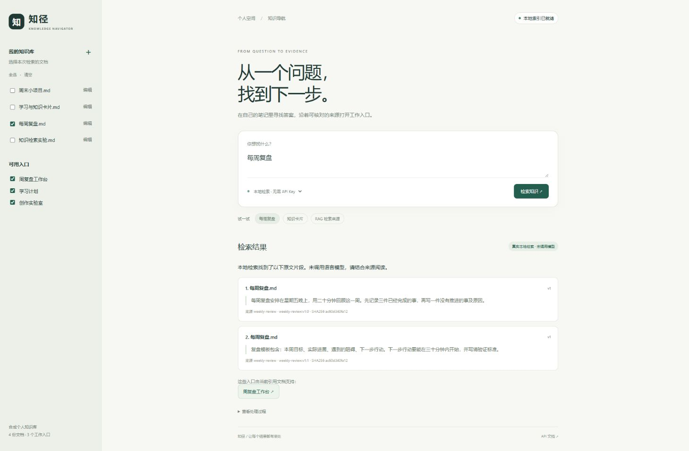

# 知径 · Knowledge Navigator Agent

**一个能跑在本机的个人知识导航项目：限定笔记范围，检索真实原文，校验引用，再推荐可打开的工作入口。**

[](https://github.com/zhyzx35607/knowledge-navigator-agent/actions/workflows/tests.yml)

采用 FastAPI、SQLite FTS5 和原生 HTML/CSS/JavaScript。无需公司平台、向量服务或模型密钥。默认模式执行实际 BM25 检索并展示原文；可选接入兼容 Chat Completions 的模型服务，由模型在有限步数内选择搜索、读取片段、提交回答，界面展示真实工具轨迹。

| 模式 | 实际行为 | 边界 |
|---|---|---|
| 本地检索（默认） | 一次 FTS5/BM25 搜索，展示原文与关联入口 | 离线可用；没有模型规划或生成答案 |
| Agent 检索（可选） | 模型决定 `search` / `read` / `final`，可根据搜索结果改写关键词 | 需要模型服务；默认最多 6 步，引用必须来自已读原文 |

## 快速启动（Windows）

需要 Python 3.12。首次安装依赖需要网络，完成后默认本地模式可以离线使用。

```powershell
powershell -ExecutionPolicy Bypass -File scripts/setup.ps1
powershell -ExecutionPolicy Bypass -File scripts/start.ps1
```

打开 **http://127.0.0.1:8792**，终端按 `Ctrl+C` 停止。若端口冲突，加 `-Port 8793`。首次启动会在 `data/knowledge.sqlite3` 创建 SQLite 数据库，内置 4 份合成个人笔记、3 个本地工作入口。

macOS/Linux 或手动启动（Python 3.11+）：

```bash
python -m venv .venv
source .venv/bin/activate
python -m pip install -r requirements.lock
python -m pip install --no-deps -e .
python -m uvicorn navigator.main:app --host 127.0.0.1 --port 8792
```

## 两分钟演示

1. 点击“每周复盘”，查看命中的“每周复盘.md”原文、版本和处理过程。
2. 点击“周复盘工作台”，确认后打开实际本地入口，查看关联笔记。
3. 只勾选“每周复盘.md”，查询 `RAG`：返回未找到，不能跨范围借用其他文档。
4. 点击左侧 `＋` 创建自己的笔记，关联入口；用独有关键词查询，随后编辑或删除，再查一次，观察索引同步更新。
5. 选择“Agent 检索”。未配置服务时明确报错；配置后可展开处理过程，检查每次搜索词、读取片段与最终校验。

入口白名单当前由内置配置建立，普通文档只能绑定已有入口，不能通过模型生成任意跳转地址。



## 可选模型

复制 `.env.example` 为 `.env`，设置：

```dotenv
MODEL_BASE_URL=http://127.0.0.1:8000/v1
MODEL_NAME=your-model
MODEL_API_KEY=
MODEL_TIMEOUT=30
MODEL_MAX_STEPS=6
```

`MODEL_BASE_URL` 为服务 base URL，程序追加 `/chat/completions`；支持无密钥的本地模型或使用自己的 API Key。Windows `scripts/start.ps1` 安全读取 `.env`，不会执行文件中的命令。其他系统请在启动前将相同变量导出到环境。不要提交 `.env`。

模型每轮必须返回一个 JSON 动作：

```json
{"action":"search","query":"每周复盘"}
{"action":"read","chunk_ids":["weekly-review:v1:0"]}
{"action":"final","answer":"根据原文整理的回答","citation_ids":["weekly-review:v1:0"],"entry_ids":["journal"]}
```

上面三行代表三轮独立输出。模型服务只需支持 Chat Completions 文本输出；本项目使用严格 JSON 动作协议，不依赖原生 function calling。`search` 真正查询 SQLite，`read` 再次读取当前原文；模型不能改变请求的文档范围，不能读取未发现片段，不能引用未读取片段。`MODEL_MAX_STEPS` 可设为 3–12，`final` 也占一步。`MODEL_TIMEOUT` 是每次模型请求的秒数上限（大于 0、不超过 120），没有无限重试。

空引用提交会被替换成服务器固定的证据不足提示，并清空入口；不会展示模型自写的无证据答案。超限、格式错误、超时、HTTP 错误、捏造引用或越权入口会明确失败，保留已经执行的动作与结果摘要供检查。轨迹不记录内部思维。用户可主动切回本地模式。

只有选择 Agent 模式才会把问题、所选文档 ID、允许入口及实际搜索/读取结果发送给配置的服务。默认的本地模式不调用外部 AI。

## 测试与验收

```powershell
powershell -ExecutionPolicy Bypass -File scripts/test.ps1
```

或 `python -m pip install -r requirements-dev.lock` 后执行 `python -m pytest -q`。当前本地验收 **44 项通过**，覆盖实际 SQLite 检索、文档范围、来源原文、入口越权拒绝、更新/删除索引、版本冲突、多轮改写搜索、伪造/未读片段、最大步数与模型异常。模型测试使用明确的 `httpx.MockTransport` 驱动动作，实际工具仍查询 SQLite；不代表真实外部模型已联网验收。CI 已配置 Windows/Linux × Python 3.11/3.12，远程运行结果应以仓库 Actions 为准。

## 代码地图

| 文件 | 责任 |
|---|---|
| `navigator/store.py` | SQLite、事务更新、分块、中文双字词、FTS5/BM25 |
| `navigator/protocol.py` | 来源、版本、原文、入口白名单结果校验 |
| `navigator/agent.py` | 严格动作协议、有限步工具循环、范围约束与轨迹 |
| `navigator/model.py` | 可选模型适配、超时与失败语义 |
| `navigator/main.py` | API、生命周期、静态页面和工作台路由 |
| `navigator/static/` | 检索、范围选择、证据展示、文档管理界面 |
| `navigator/demo.json` | 新建的合成个人知识库和入口 |
| `tests/test_api.py` | 本地集成测试与模型协议测试 |

[架构与协议](docs/architecture.md) · [验收记录](docs/verification.md) · [简历与演示材料](docs/resume.md) · 运行后交互式 API 文档 `/docs`

## 来源与许可

本项目从已有 RAG 辅助搜索中抽取“范围 → 来源 → 入口白名单 → 确认打开”的通用边界，并独立补齐本地后端、索引、界面和测试。没有携带公司数据、原平台认证、私有依赖或 Git 历史。

新增代码使用 MIT；适配的 `navigator/protocol.py` 使用 Mulan PSL v2。来源版本、文件路径和完整许可证见 [THIRD_PARTY_NOTICES.md](THIRD_PARTY_NOTICES.md)。

## 当前边界

这是单人本地应用，默认仅监听本机地址，没有多用户鉴权。中文检索使用双字词与关键词排序，尚无语义向量召回；模型引用校验保证来源确实存在，不自动证明答案语义正确。文档支持纯文本/Markdown 内容编辑，暂未接 PDF/Word 解析。没有配置真实模型服务时，不声称完成外部模型验收。
