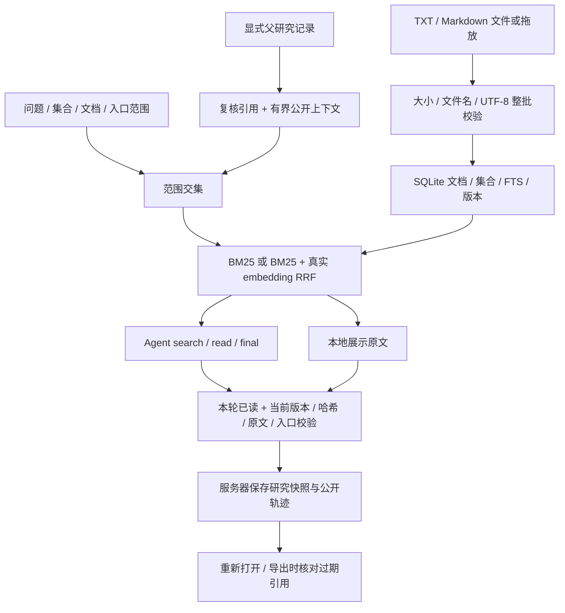

# v0.2 架构与数据约束

## 数据与迁移

`initialize` 幂等创建 collections、research_records、embedding_vectors，检测旧 documents 列后增加 collection_id。已有文档/FTS/版本不重写；metadata.seeded 保留用户删空状态。删除集合使用外键 SET NULL，删除文档使用片段级 CASCADE 同步清理向量缓存。研究快照不使用文档外键，因此删除原文仍保留历史证据。

文档保存先 BEGIN IMMEDIATE，再校验 expected_version 和入口，事务内更新文档/分块/FTS。批量导入先验证所有文件，再一个事务写入全部。正文仍按段落分成最多 500 字符的片段，来源 ID 包含文档版本；没有引入新的 chunking 算法或 PDF 解析。

## 检索与范围

请求 document_ids 与 collection_ids 取交集；null 表示全部，空列表表示空范围。续问再与父记录的实际文档/入口范围取交集。BM25 SQL 和 dense 候选 SQL 都先应用范围，范围外文本不进入 embedding 请求。BM25 两路候选版本不一致时明确失败，最终引用还会重新核对当前版本。

可选向量服务实际调用 /embeddings，返回有限、非零且维度一致的向量。稳定余弦计算先按最大绝对值缩放，避免有限极值溢出。向量候选应用可配置阈值；两路各30候选通过 k=60 的 RRF 融合，最终6片段。模型配置指纹、片段版本、正文digest共同确定缓存。不存在随机或哈希向量生产后备。

## 续问和研究记录

研究记录仅由服务器搜索流创建，保存真实结果或安全失败与查询、实际范围、引用、检索信息、公开动作摘要。重新打开和导出在同一 SQLite 读快照中核对引用，逐项产生 stale/stale_reason；历史回答不改变。无引用记录为 evidence_status=none。

显式续问最多读取一层父记录；已过期父引用返回409。公开上下文最多问题400字符、回答1200字符、3段各180字符引用。缩小范围不注入旧回答，并过滤范围外引用。Agent 必须重新调用 search/read，不能直接使用父引用提交 final。本地续问明确采用关键词拼接，不把历史 CRUD 叫自动长期记忆。

## 轨迹与评测

trace 记录真实动作、参数摘要、片段ID、模型耗时、工具耗时、召回路径及缓存计数，不记录隐藏思维或密钥。研究记录ID串联一次执行结果与导出。

20题golden由生产API在临时库运行，分别统计BM25与真实hybrid。无真实向量配置时hybrid skipped。结果包括每题排名/原文覆盖/范围泄漏/拒答、数据集哈希、代码revision、环境和延迟。MockTransport只用于接口和约束回归，不能作为真实语义效果证据。
