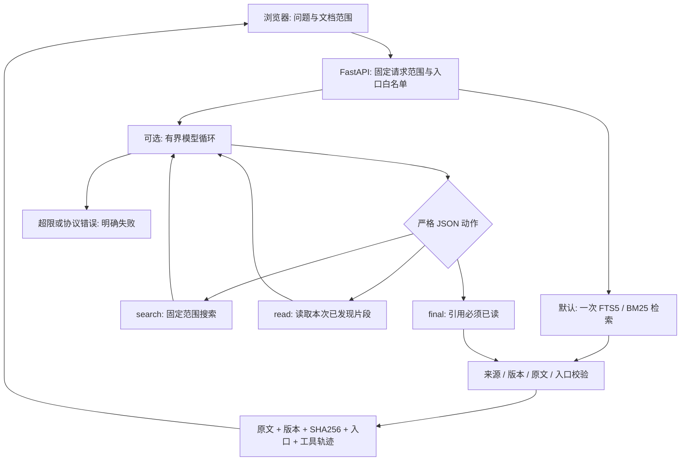

# 架构与协议

## 检索与索引

`Store` 用 SQLite 保存文档、入口、原文片段和 FTS5 索引；文档写入、旧索引删除和新索引写入处于同一事务。中文连续文本生成重叠双字词，英文生成小写单词。查询用参数化 MATCH 表达式与文档 ID SQL 过滤，按 BM25 排序，每次最多返回 6 个片段。这是关键词检索，不是 embedding/向量数据库；错别字、同义词、单字查询和语义推断能力有限。中文单字查询仅在单字词条中匹配。

每个片段最多 500 字符。文档更新使版本递增，并更新正文 SHA256。来源 ID 为 `document_id:v<version>:<chunk_number>`。删除文档同步删除索引。第一次建库才加入演示数据；用户删空后不会再次播种。

## 请求范围

`POST /api/search` 接收 `query`、`document_ids`、`entry_ids`、`mode`。范围为 `null` 表示请求开始时本地库的所有资源，`[]` 表示空范围。不存在的 ID 返回 403，不扩大范围。这里是单人本地应用的检索范围，不是多租户身份认证系统。

范围与入口白名单在请求开始时固定。每次 `search` 和 `read` 都把原始范围传入 SQL 过滤；模型不能提供新的 `document_ids`。这种字段会因 `extra=forbid` 被拒绝。只依靠提示词约束模型不够，数据访问与最终引用都由后端检查。

## 有限步 Agent

`navigator/agent.py` 调用 `ModelClient.next_action(messages)`，每轮接受一个严格 JSON 动作。聊天历史只追加经校验的动作和实际工具输出，没有内部思维字段，也不保存会话到数据库。

| 动作 | 输入 | 真实执行及限制 |
|---|---|---|
| `search` | `query`，1–400 字符 | 固定范围内 FTS5/BM25 检索，返回 ID、标题和最多 120 字符预览；可多轮改写关键词 |
| `read` | `chunk_ids`，1–6 个 | 只接受本次搜索发现的 ID，再读取数据库当前完整片段；更新/删除后旧 ID 失效 |
| `final` | `answer`、`citation_ids`、`entry_ids` | 引用必须已经通过 read，随后执行版本、哈希、原文、范围和入口校验 |

默认最多 6 次模型动作，可配置 3–12 次，`final` 也占一步。每次模型请求有独立超时，最多 120 秒；不自动重试或回退为本地成功。初始问题不必直接命中：模型可先搜索、查看空结果、改写查询、读取证据再回答。该流程使用文本 JSON 协议，不要求服务支持原生工具调用格式。

轨迹记录动作类型、轮次、搜索词/片段 ID、命中/读取数量、模型调用耗时和校验结果。失败响应包含已完成轨迹与拒绝原因；不含上游原始错误、密钥或模型内部思维。

## 最终结果校验

非空引用必须来自本次已读原文且仍在请求范围内；版本、正文哈希、原文片段必须匹配当前文档。入口必须同时存在于服务器白名单、本次选中白名单、被引用文档的关联入口中。入口路径由服务器返回，模型不能提供 URL。

空 `citation_ids` 且空 `entry_ids` 表示弃答：服务器返回 `status=not_found` 和固定的证据不足文案，丢弃模型自行生成的 answer。无引用却推荐入口则拒绝。`not_found` 表示没有提交可用证据，不代表模型穷尽了整个知识库。

检查结构与来源真实性不能证明答案每句话都符合原文。UI 展示原文供用户核对。需要事实级自动评估时，应另建人工标注问答集。

## 失败语义

- 本地未命中：200 / `status=not_found`，空引用与入口，`model_called=false`。
- 模型明确弃答：200 / `status=not_found`，固定文案、空引用与入口、真实调用次数。
- 未配置、模型 HTTP 错误、超时、无效 JSON、非法动作或越权：502，`detail` 内含 `status=failed`、错误码、消息和轨迹。
- 已达到最大动作步数却没有有效 final：502 / `code=max_steps`；不会把最后一次搜索伪装成答案。
- 文档版本冲突：409。检索后文档变更会在 read 或最终校验时拒绝旧证据。
- 请求非法：422。文档/入口不存在：403 或 404。

网络模型只在选择 Agent 模式时调用；发送问题、所选文档 ID、允许入口元数据及工具结果。不发送数据库文件、不记录模型密钥或完整上游错误。默认仅监听 `127.0.0.1`；应用没有多用户鉴权，当前范围是本地个人使用。
